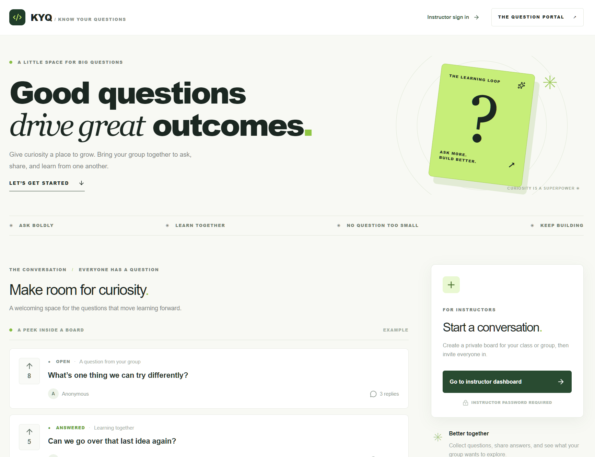
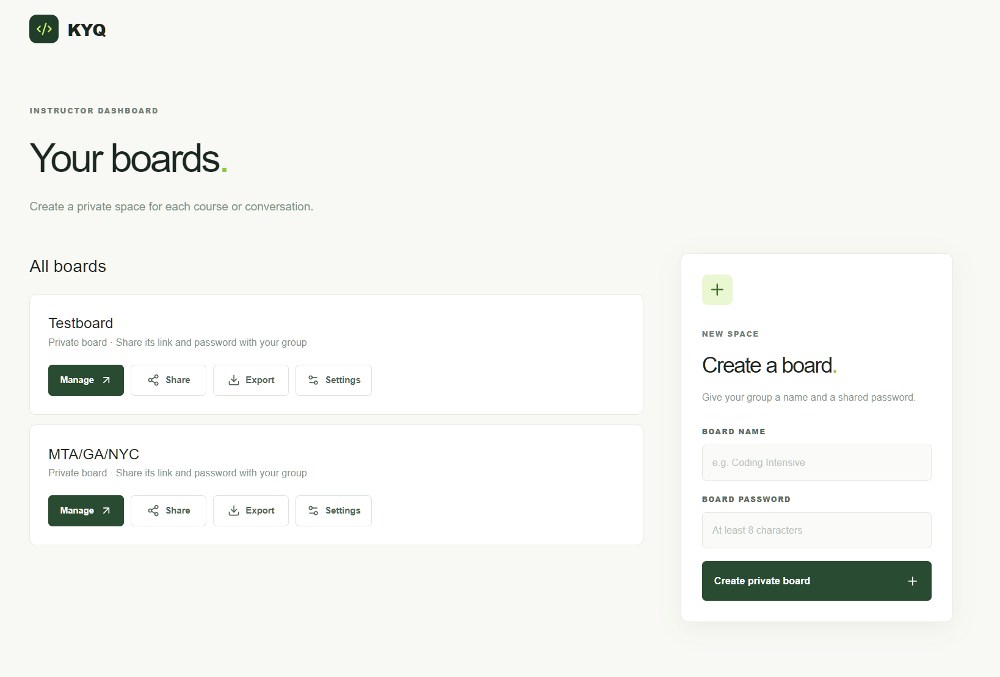
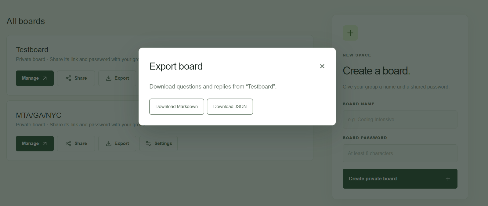

# Know Your Questions


**Make room for the questions that move learning forward.**

Know Your Questions (KYQ) gives classrooms, coding intensives, and learning groups a shared place to ask, discuss, and discover what needs attention. Participants can contribute without creating an account, while instructors get a focused view of the conversation and tools to guide it.

From the question someone hesitated to ask to the topic the whole room wants to revisit, KYQ helps turn curiosity into a more useful conversation.

## A little space for big questions

- **Give everyone a voice.** Participants can post with an optional name and lesson reference, then continue the conversation in replies.
- **Surface what matters.** Upvotes and Hot, New, and FAQ views help the group find timely and answered questions.
- **Keep the room in sync.** Live Firestore updates bring new activity into view as it happens.
- **Guide the conversation.** Instructors can manage questions, set their status, and use presenter mode during a session.
- **Take the learning with you.** Export questions and replies as Markdown or JSON.



## Built for instructors and groups

Create a password-protected board for each course or conversation. Share its link or QR code with your group, and participants can unlock the board to ask, vote, and reply. The instructor dashboard keeps boards, sharing, settings, and exports close at hand.



Questions and replies support formatting such as bold, italics, lists, and tables. Markdown exports preserve that formatting, making it easy to keep a record or bring the conversation into another workflow.



## Under the hood

KYQ is a Next.js App Router application built with React, TypeScript, and Tailwind CSS. Firebase Authentication provides browser identities and board-specific access; Cloud Firestore stores boards and questions and delivers live updates. Next.js route handlers use the Firebase Admin SDK for server-side operations such as board access, management, and exports. Firestore security rules enforce board access for client operations.

The instructor account area at `/instructor` uses a separate Firebase email/password identity and creates a personal team after email verification. Team owners can invite additional owners, and owners and board admins can invite managers to individual boards with different permission levels. See [instructor accounts and roles](docs/instructor-accounts.md).

| Location | Purpose |
| --- | --- |
| `app/` | Pages, board and instructor interfaces, and API route handlers |
| `lib/` | Shared types, Firebase client configuration, and server utilities |
| `firestore.rules` | Firestore access and validation rules |
| `scripts/` | Firestore rules and board API integration scripts |

## Getting started

### Prerequisites

- Node.js and npm
- A Firebase project with a web app, **Anonymous** sign-in enabled, and a Firestore database
- **Email/Password** sign-in enabled in Firebase Authentication for the new instructor account flow; configure authorized domains and Firebase's verification and password-reset email templates for the deployed URL
- Firebase Admin credentials for the server, plus the Firebase CLI if deploying Firestore rules

### Configure and run

1. Install dependencies:

   ```sh
   npm install
   ```

2. Copy `.env.example` to `.env.local` and fill in the Firebase web app configuration from the Firebase console. Set a long, random session secret for password-attempt identifiers.

3. Give the server Firebase Admin credentials using **one** of these options:
   - Set `GOOGLE_APPLICATION_CREDENTIALS` to the path of a service-account JSON file.
   - Set `FIREBASE_SERVICE_ACCOUNT_JSON` to the service-account JSON contents.
   - Use Application Default Credentials in an environment where they are available.

   Keep the service-account credentials and `SESSION_SECRET` secret. Do not prefix them with `NEXT_PUBLIC_` or commit them to the repository.

4. Deploy the Firestore rules to your Firebase project:

   ```sh
   firebase deploy --only firestore:rules --project YOUR_PROJECT_ID
   ```

5. Start the development server:

   ```sh
   npm run dev
   ```

   Open [http://localhost:3000](http://localhost:3000), or visit [instructor accounts](http://localhost:3000/instructor) to create an account and board.

### Environment variables

| Variable | Purpose |
| --- | --- |
| `NEXT_PUBLIC_FIREBASE_API_KEY` | Firebase web app API key |
| `NEXT_PUBLIC_FIREBASE_AUTH_DOMAIN` | Firebase Authentication domain |
| `NEXT_PUBLIC_FIREBASE_PROJECT_ID` | Firebase project ID |
| `NEXT_PUBLIC_FIREBASE_APP_ID` | Firebase web app ID |
| `SESSION_SECRET` | Secret used to protect password-attempt identifiers |
| `FIREBASE_SERVICE_ACCOUNT_JSON` | Optional service-account JSON for the server |
| `GOOGLE_APPLICATION_CREDENTIALS` | Optional path to a service-account JSON file |

## Using a board

1. Create an account or sign in at `/instructor`, then verify your email.
2. Create a board with a name and a participant password of at least eight characters.
3. Use **Share** to copy the board link or download its QR code, and share the password separately with participants.
4. Participants open the link, unlock the board, and can ask, vote, and reply. Instructors can open **Manage board** to moderate questions and change their status.

Questions and replies support visual formatting, including bold, italics, lists, and tables. Their Markdown formatting is retained in Markdown exports. The 2,000-character limit and editor counter measure the stored Markdown, including formatting characters.

Changing a board password requires participants to unlock it again. Deleting a board permanently removes its questions and replies; export it first if you need a copy.
If deletion is interrupted, the dashboard shows the board as unavailable and offers authorized admins **Finish deletion** to retry.

Owners and board admins can open **Managers** to create a board-specific invitation for a verified email address. Copy and share the one-time link with that person; it expires after seven days and can be revoked. Responders can reply and change question status; moderators can also delete questions and replies; managers can also change the participant password and export; board admins can also edit questions, manage access, and delete the board. Each role includes the preceding roles. The owner retains access and creates boards for the team.

Use **Team owners** to invite a trusted co-owner, review ownership activity, revoke invitations, or remove an owner. Share the one-time invitation link directly; the recipient must sign in with its verified email and accept within seven days. All owners can manage every team board and invite or remove owners. A team must retain at least one owner; two are recommended for continuity. Ownership changes require password confirmation. Email notifications and recovery when all owners lose access are not yet available.

Boards created under the former shared instructor login remain unassigned and inaccessible. Migrating them is outside the current scope.

## Privacy and deployment

Board passwords are salted and hashed on the server. After a participant unlocks a board, Firestore rules check a board-specific Firebase token and its access version. Access persists in the same browser until the password changes, the participant locks the board or signs out, or site data is cleared. Use HTTPS and strong, unique passwords; anyone with a board password can access that board.

Password attempts are limited in Firestore by client IP. This depends on correct trusted proxy and IP configuration. The question-posting cooldown is a client-side convenience, not a server-enforced spam limit. Anonymous Firebase identities are browser-specific and can change when site data is cleared.

Deploy the app and `firestore.rules` together, especially when updating board access behavior. The rules deny access to the original single-board collection. Coordinate deployment: publishing the rules first interrupts the old app, while publishing the app first temporarily prevents access to new boards.

## Commands

| Command | Description |
| --- | --- |
| `npm run dev` | Start the development server |
| `npm run build` | Create a production build |
| `npm start` | Run the production build |

The repository also contains Firestore rules and instructor board API integration scripts in `scripts/`; see [the emulator instructions](docs/instructor-accounts.md). The default `npm test` script is a placeholder.
